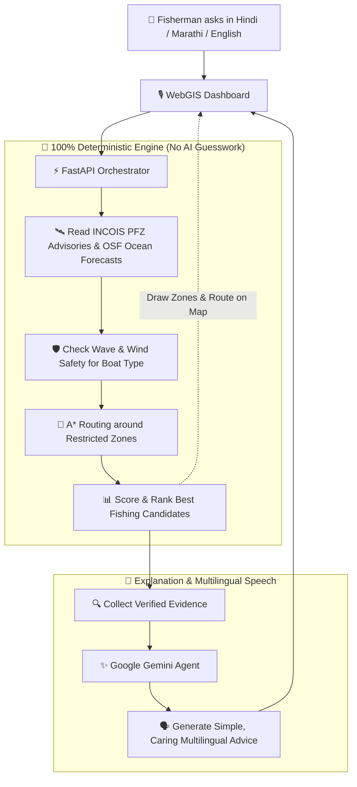

# 🌊 Project ORCA (Marine Intelligence for Fishermen)

<div align="center">

### 🛰️ Marine Ecosystem Reasoning with Collaborative Agents
**Smart India Hackathon (SIH 2026) • Problem Statement: SIH26176 • ISRO & INCOIS**

[](https://www.sih.gov.in/)
[](https://python.org)
[](https://fastapi.tiangolo.com/)
[](https://leafletjs.com/)
[](https://ai.google.dev/)

<p align="center">
  <b>Transforming satellite Earth Observation & ocean forecast data into actionable, evidence-grounded decision-support advisories for coastal fishermen. 🇮🇳</b>
</p>

[💡 The Problem](#-why-we-built-this-the-problem) •
[✨ What ORCA Does](#-what-orca-does) •
[🛠️ Tech Stack](#-tech-stack-we-used) •
[🚀 How to Run It](#-how-to-run-it-locally) •
[🚢 Vessel Safety Limits](#-vessel-safety-limits) •
[📡 API Endpoints](#-api-endpoints) •
[👥 Team & Credits](#-team--acknowledgements)

---

</div>

## 💡 Why We Built This (The Problem)

Every single day, Indian space and ocean agencies like **ISRO** and **INCOIS** generate authoritative satellite datasets — Sea Surface Temperature (SST), Chlorophyll levels, Potential Fishing Zones (PFZs), wave heights, and weather forecasts.

**The Catch?** 🎣  
Most artisanal fishermen head out into deep waters in small wooden boats or trawlers without access to easy-to-understand information. Complex `.xls` coordinate sheets or technical meteorological maps are impractical to read on a rocking boat under the sun.

**Our Solution — ORCA:**  
We created an intelligent decision-support platform that lets a fisherman simply speak or ask a question in **Hindi, Marathi, or English** (e.g. *"Where is the best safe fishing spot today near Mumbai?"*). ORCA handles the spatial calculations, checks wave hazards against configured thresholds, finds the shortest safe route, and explains everything clearly with evidence-grounded AI synthesis!

---

## ✨ What ORCA Does

- 🎙️ **Voice & Regional Languages:** Speak naturally in Hindi, Marathi, or English.
- 🐟 **Smart PFZ Matching:** Reads INCOIS Potential Fishing Zone advisories to find candidate high-yield spots.
- 🛡️ **Deterministic Safety Verification:** All sea-state checks, wave limits, and geodesic calculations are computed by deterministic Python GIS logic. Language models are strictly grounded on verified structured telemetry.
- 🧭 **A\* Safe Corridor Routing:** Calculates path recommendations for boats while avoiding restricted marine boundaries and hazards.
- 🗺️ **Cyber-Ocean WebGIS Dashboard:** A responsive, glassmorphism radar map built with Leaflet for visual situational awareness.
- 🔍 **Inspectable Evidence Ledger:** Every recommendation clearly exposes data provenance (agency source, timestamp, live/cached status, quality level).

---

## 🏗️ How It Works (Under the Hood)

Here is a quick look at how ORCA processes a question step-by-step:



---

## 🛠️ Tech Stack We Used

- **Frontend:** HTML5, Modern CSS (Glassmorphism "Cyber-Ocean" theme), Vanilla JS, **Leaflet.js** (WebGIS map).
- **Backend:** **Python 3.10+**, **FastAPI**, Uvicorn, Pydantic.
- **AI & Speech:** Google Gemini API (Natural language explanation & intent classification) + Web Speech API.
- **GIS & Algorithms:** Custom **A\* Pathfinding** routing, Haversine spatial calculations, CZMP boundary geofencing.
- **Data Ingestion:** Parsers for INCOIS `.xls` PFZ advisories, live/cached Ocean State Forecasts (OSF), and boundary JSON manifests.

---

## 🚀 How to Run It Locally

You can set this up on your local machine in just a few minutes! 💻

### ⚡ Option A: Quick Start (Windows One-Click)
Double-click [`run.bat`](./run.bat) or run it in your terminal:
```cmd
.\run.bat
```
*(This automatically verifies Python, creates `venv`, installs missing dependencies, opens `http://127.0.0.1:8000/` in your browser, and launches Uvicorn!)*

---

### 🛠️ Option B: Manual Setup

#### 1️⃣ Clone the Repo
```bash
git clone https://github.com/Legend2006H/ISRO-ORCA-Project.git
cd ISRO-ORCA-Project
```

#### 2️⃣ Set Up a Virtual Environment
```bash
# On Windows (PowerShell):
python -m venv venv
.\venv\Scripts\Activate.ps1

# On Linux / macOS:
python3 -m venv venv
source venv/bin/activate
```

#### 3️⃣ Install Required Packages
```bash
pip install -r requirements.txt
```

#### 4️⃣ Set Up Environment Variables (Optional)
```bash
cp .env.example .env
```
Key configuration variables:
- `GEMINI_API_KEY`: API key for Google Gemini generative explanation (optional; system falls back cleanly to deterministic GIS agent if not configured).
- `CORS_ORIGINS`: Comma-separated list of allowed origins (defaults to `http://127.0.0.1:8000,http://localhost:8000,http://127.0.0.1:3000,http://localhost:3000`).
- `GEMINI_MODEL`: Specific Gemini model to target (defaults to `gemini-2.0-flash`, `gemini-1.5-flash`).

#### 5️⃣ Run the Server
```bash
uvicorn api.main:app --reload
```

#### 6️⃣ Open in Browser! 🎉
Navigate to **`http://127.0.0.1:8000`** in your browser to see the dashboard.

---

## 🚢 Prototype Vessel Safety Limits

The vessel limits configured below serve as **Category B: Prototype Operational Assumptions** for decision-support demonstration:

| Boat Type | Max Wave Height 🌊 | Max Wind Speed 💨 | Safe Range 📍 | Operational Assumption |
| :--- | :---: | :---: | :---: | :--- |
| 🛶 **Small Boat** | `1.5 m` | `10 m/s` (~19 kts) | `80 km` | Artisanal canoes & small outboard motorboats. |
| 🚤 **Trawler** | `2.5 m` | `15 m/s` (~29 kts) | `180 km` | Motorized mechanized coastal trawlers. |
| 🚢 **Deep Sea Vessel** | `4.0 m` | `22 m/s` (~43 kts) | `450 km` | Commercial offshore fishing vessels. |

> ℹ️ **Maritime Safety Note:** For real-world commercial or artisanal deployment, these operational parameters must be calibrated against authoritative maritime guidance (e.g., Directorate General of Shipping, IMO standards, INCOIS warnings) and vessel-specific survey certifications.

---

## 🛰️ Live vs. Cached Data Transparency

ORCA maintains explicit data provenance and does not misrepresent data states:
- **`LIVE` Mode**: Real-time telemetry fetched directly from external marine APIs (Open-Meteo).
- **`CACHED` Mode**: Offline validated datasets (INCOIS `.xls` PFZ advisories and historical `.nc`/`.json` OSF forecasts) with auditable timestamps.
- **`DEMO` Mode**: Synthetic spatial-temporal physical telemetry simulation used when live network streams are unreachable.

---

## 📡 API Endpoints

If you want to test the backend API directly via Swagger UI (`http://127.0.0.1:8000/docs`):

| Endpoint | Method | What it does |
| :--- | :---: | :--- |
| `/health` | `GET` | System health check, source mode (`LIVE`/`CACHED`/`DEMO`), and Gemini configuration status. |
| `/api/v1/chat` | `POST` | Core decision-support endpoint (query, GPS coordinates, language, vessel profile). |
| `/api/v1/pfz/all` | `GET` | Candidate Potential Fishing Zones as GeoJSON. |
| `/api/v1/boundaries/all` | `GET` | Coastal boundaries & CZMP geofences. |
| `/api/v1/ocean/live` | `GET` | Real-time / fallback sea-state telemetry for coordinates. |
| `/api/v1/route` | `POST` | Calculates an A\* safe corridor route avoiding geofenced hazards. |
| `/api/v1/vessels` | `GET` | Lists configured vessel profiles and prototype thresholds. |
| `/api/v1/evidence/{id}` | `GET` | Fetches specific evidence record by ID. |

---

## 📂 Project Structure

```text
ISRO-ORCA-Project/
├── 🌐 index.html             # The main WebGIS mission-control dashboard
├── 🎨 styles.css             # Neon/ocean glassmorphism styling
├── ⚡ app.js                 # Frontend interactions, map plotting & speech
├── 📄 requirements.txt       # Python dependencies
├── 📁 api/                   # Backend services
│   ├── main.py               # FastAPI server & CORS configuration
│   ├── models.py             # Schemas & prototype vessel profiles
│   ├── offline_service.py    # Deterministic calculation & fallback engine
│   ├── gemini_agent.py       # Evidence-grounded Gemini prompt integration
│   ├── incois_osf.py         # INCOIS Ocean State Forecast adapter
│   ├── live_marine.py        # Marine weather telemetry fetcher
│   ├── pfz_import.py         # Excel (.xls) PFZ advisory parser
│   ├── boundary_import.py    # Restricted zone validator
│   ├── routing.py            # A* shortest safe path algorithm
│   └── scoring.py            # Zone safety & yield scoring engine
└── 📁 data/                  # Sample datasets & manifests
    ├── manifests/            # Boundary definitions
    └── raw/                  # PFZ advisories & cached ocean observations
```

---

## ⚠️ Important Note & Disclaimers

> 🚨 **Decision-Support Disclaimer:** This software is built as a hackathon prototype for operational decision support. In demonstration/cached mode, data is simulated or cached from historical records. Coastal operators must always verify official VHF radio broadcasts, IMD meteorological alerts, and local port authority warnings before heading to sea!

> 🔒 **Security Notice:** Any development credentials or API keys previously exposed in git history must be rotated and revoked externally on the provider console. Real credentials should only be provided via local `.env` or deployment environment variables.

---

## 👥 Team & Acknowledgements

- 🏆 **Hackathon:** Smart India Hackathon (SIH 2026)
- 🚀 **Problem Statement:** SIH26176 (ISRO / INCOIS)
- 💙 **Special Thanks:** To **ISRO** and **INCOIS** for open oceanographic & Earth Observation data initiatives.

---

<div align="center">
 
</div>
