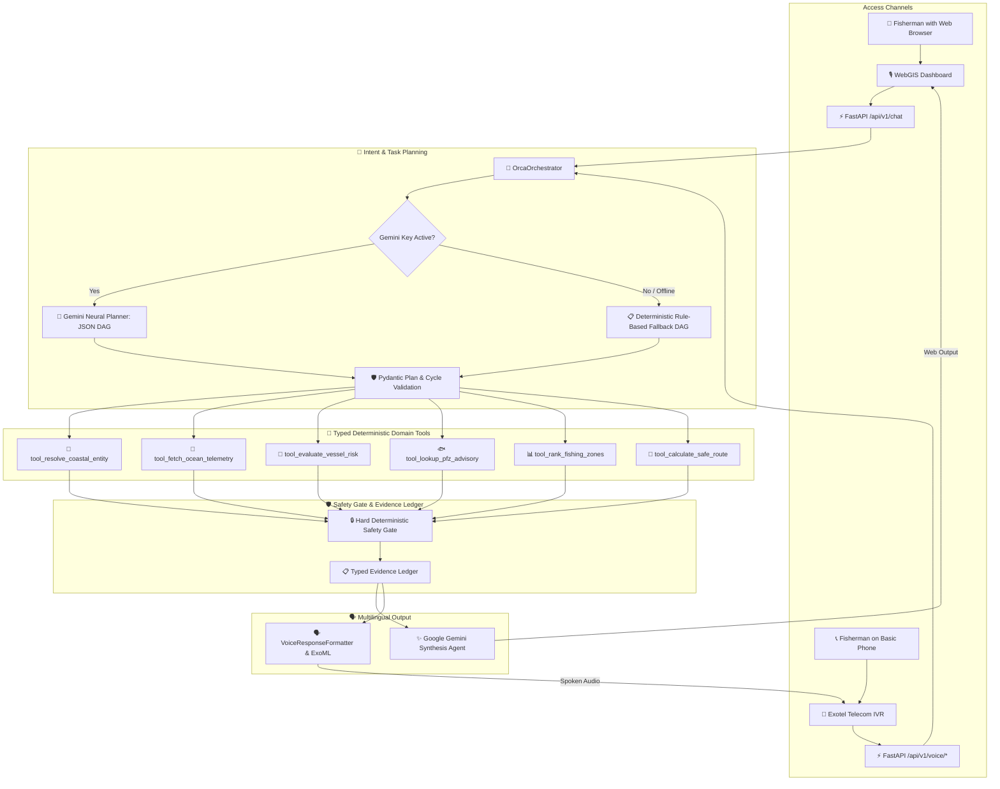

# 🌊 Project ORCA (Marine Intelligence for Fishermen)

<div align="center">

### 🛰️ Marine Ecosystem Reasoning with Collaborative Agents
**Smart India Hackathon (SIH 2026) • Problem Statement: SIH26176 • ISRO & INCOIS**

[](https://www.sih.gov.in/)
[](https://python.org)
[](https://fastapi.tiangolo.com/)
[](https://leafletjs.com/)
[](https://ai.google.dev/)

<p align="center">
  <b>Transforming satellite Earth Observation & ocean forecast data into actionable, evidence-grounded decision-support advisories for coastal fishermen. 🇮🇳</b>
</p>

[💡 The Problem](#-why-we-built-this-the-problem) •
[✨ What ORCA Does](#-what-orca-does) •
[📞 Voice Helpline (No Internet)](#-cellular-voice-helpline-no-internet-required) •
[🏗️ Architecture](#️-how-it-works-multi-agent-architecture) •
[🛠️ Tech Stack](#️-tech-stack-we-used) •
[🚀 Local Setup](#-how-to-run-it-locally) •
[☁️ Cloud Deployment (Render)](#️-production-deployment-on-render--environment-variables) •
[🚢 Safety Limits](#-prototype-vessel-safety-limits) •
[📡 API Endpoints](#-api-endpoints) •
[👥 Team & Credits](#-team--acknowledgements)

---

</div>

## 💡 Why We Built This (The Problem)

Every single day, Indian space and ocean agencies like **ISRO** and **INCOIS** generate authoritative satellite datasets — Sea Surface Temperature (SST), Chlorophyll levels, Potential Fishing Zones (PFZs), wave heights, and weather forecasts.

**The Catch?** 🎣  
Most artisanal fishermen head out into deep waters in small wooden boats or trawlers without access to easy-to-understand information. Complex `.xls` coordinate sheets or technical meteorological maps are impractical to read on a rocking boat under the sun.

**Our Solution — ORCA:**  
We created an intelligent dual-channel decision-support platform:
1. **WebGIS Radar Dashboard:** For smartphones & laptops with internet access.
2. **Cellular IVR Voice Helpline:** For basic 2G/keypad phones with **zero mobile internet required**!

---

## ✨ What ORCA Does

- 🎙️ **Voice & Regional Languages:** Speak or listen naturally in Hindi, Marathi, or English.
- 📞 **Zero-Internet Cellular Helpline:** Dial from any basic keypad mobile phone to receive spoken advisories over phone calls via Exotel IVR.
- 🐟 **Smart PFZ Matching:** Reads INCOIS Potential Fishing Zone advisories to find candidate high-yield spots.
- 🛡️ **Deterministic Safety Verification:** All sea-state checks, wave limits, and geodesic calculations are computed by deterministic Python GIS logic. Language models are strictly grounded on verified structured telemetry.
- 🧭 **A\* Safe Corridor Routing:** Calculates path recommendations for boats while avoiding restricted marine boundaries and hazards.
- 🗺️ **Cyber-Ocean WebGIS Dashboard:** A responsive, glassmorphism radar map built with Leaflet for visual situational awareness.
- 🔍 **Inspectable Evidence Ledger:** Every recommendation clearly exposes data provenance (agency source, timestamp, live/cached status, quality level).

---

## 📞 Cellular Voice Helpline (No Internet Required)

For artisanal fishermen without smartphones or mobile data packages:
1. **Dial the ORCA Helpline Number** from any standard mobile phone.
2. **Keypad DTMF Selection:**
   - **Language:** `1` = Marathi (`मराठी`), `2` = Hindi (`हिंदी`), `3` = English
   - **Service:** `1` = Marine Safety, `2` = Nearest PFZ, `3` = Safe Route
   - **Port:** `1` = Mumbai, `2` = Ratnagiri, `3` = Malvan, `4` = Alibaug, `5` = Dahanu
3. **Spoken Voice Advisory:** The caller immediately hears live sea-state observations, wave heights, and vessel-specific departure clearance.

---

## 🏗️ How It Works (Multi-Agent Architecture)

ORCA implements a **Bounded Multi-Agent Orchestrator over Typed Deterministic Domain Tools** (ISRO PS 26176):



---

## 🛠️ Tech Stack We Used

- **Frontend:** HTML5, Modern CSS (Glassmorphism "Cyber-Ocean" theme), Vanilla JS, **Leaflet.js** (WebGIS radar map).
- **Backend:** **Python 3.10+**, **FastAPI**, Uvicorn, Pydantic v2.
- **Telephony & IVR:** **Exotel Programmable Voice API** (ExoML XML, DTMF keypress parsing, in-memory TTL sessions).
- **Agentic AI & Speech:** Google Gemini API (Structured task planning & multilingual conversational synthesis) + Web Speech API.
- **GIS & Pathfinding:** Custom **A\* Grid Pathfinding** routing with Chaikin corner smoothing, Haversine geodesic calculations, CZMP boundary geofencing.
- **Data Ingestion:** Parsers for INCOIS `.xls` PFZ advisories, live/cached Ocean State Forecasts (OSF), and boundary CSV manifests.
- **Test Suite:** **Pytest** (50/50 automated unit tests passing in ~6.0s).

---

## 🚀 How to Run It Locally

You can set this up on your local machine in just a few minutes! 💻

### ⚡ Option A: Quick Start (Windows One-Click)
Double-click [`run.bat`](./run.bat) or run it in your terminal:
```cmd
.\run.bat
```
*(This automatically verifies Python, creates `venv`, installs missing dependencies, opens `http://127.0.0.1:8000/` in your browser, and launches Uvicorn!)*

---

### 🛠️ Option B: Manual Setup

#### 1️⃣ Clone the Repo
```bash
git clone https://github.com/adityashinde0/ISRO-ORCA-Project.git
cd ISRO-ORCA-Project
```

#### 2️⃣ Set Up a Virtual Environment
```bash
# On Windows (PowerShell):
python -m venv venv
.\venv\Scripts\Activate.ps1

# On Linux / macOS:
python3 -m venv venv
source venv/bin/activate
```

#### 3️⃣ Install Required Packages
```bash
pip install -r requirements.txt
```

#### 4️⃣ Set Up Environment Variables (Optional)
```bash
cp .env.example .env
```
Key configuration variables:
- `GEMINI_API_KEY`: API key for Google Gemini generative planning & explanation (optional; system falls back cleanly and instantly to deterministic rule planner if not configured).
- `CORS_ORIGINS`: Comma-separated list of allowed origins (defaults to `http://127.0.0.1:8000,http://localhost:8000,http://127.0.0.1:3000,http://localhost:3000`).
- `GEMINI_MODEL`: Specific Gemini model to target (defaults to `gemini-2.0-flash`, `gemini-1.5-flash`).
- `EXOTEL_ACCOUNT_SID`: (Optional) Exotel Account SID for live cellular helpline integration.
- `EXOTEL_API_KEY`: (Optional) Exotel API Key.
- `EXOTEL_API_TOKEN`: (Optional) Exotel API Token.
- `EXOTEL_PHONE_NUMBER`: (Optional) Exotel Virtual Phone Number.

#### 5️⃣ Run Automated Tests
```bash
pytest
```
*(Runs all 50 unit tests verifying multi-agent orchestration, safety gates, PFZ ingestion, A\* routing, and Exotel voice IVR in ~6.0s).*

#### 6️⃣ Run the Server
```bash
uvicorn api.main:app --reload
```

#### 7️⃣ Open in Browser! 🎉
Navigate to **`http://127.0.0.1:8000`** in your browser to see the dashboard.

---

## ☁️ Production Deployment on Render & Environment Variables

When deploying ORCA to **Render**, configure the following environment variables in the Render Dashboard (**Environment** tab):

| Variable Name | Purpose | Example Value | Required? |
| :--- | :--- | :--- | :---: |
| `GEMINI_API_KEY` | Google Gemini AI Key for task planning & conversational synthesis. | `AIzaSy...` | Optional (falls back to deterministic engine) |
| `CORS_ORIGINS` | Allowed origins for web API requests. | `https://orca-marine.onrender.com,http://localhost:8000` | Recommended |
| `EXOTEL_ACCOUNT_SID` | Exotel Account SID for cellular helpline webhook authentication. | `your_account_sid` | Optional (for real Exotel calls) |
| `EXOTEL_API_KEY` | Exotel API Key. | `your_api_key` | Optional |
| `EXOTEL_API_TOKEN` | Exotel API Token. | `your_api_token` | Optional |
| `EXOTEL_PHONE_NUMBER` | Virtual number assigned to your Exotel IVR applet. | `08047101234` | Optional |
| `ORCA_ENV` | Runtime environment identifier. | `production` | Recommended |

### Render Build & Start Commands:
- **Build Command:** `pip install -r requirements.txt`
- **Start Command:** `uvicorn api.main:app --host 0.0.0.0 --port $PORT`

---

## 🚢 Prototype Vessel Safety Limits

The vessel limits configured below serve as **Category B: Prototype Operational Assumptions** for decision-support demonstration:

| Boat Type | Max Wave Height 🌊 | Max Wind Speed 💨 | Safe Range 📍 | Operational Assumption |
| :--- | :---: | :---: | :---: | :--- |
| 🛶 **Small Boat** | `1.5 m` | `10 m/s` (~19 kts) | `80 km` | Artisanal canoes & small outboard motorboats. |
| 🚤 **Trawler** | `2.5 m` | `15 m/s` (~29 kts) | `180 km` | Motorized mechanized coastal trawlers. |
| 🚢 **Deep Sea Vessel** | `4.0 m` | `22 m/s` (~43 kts) | `450 km` | Commercial offshore fishing vessels. |

> ℹ️ **Maritime Safety Note:** For real-world commercial or artisanal deployment, these operational parameters must be calibrated against authoritative maritime guidance (e.g., Directorate General of Shipping, IMO standards, INCOIS warnings) and vessel-specific survey certifications.

---

## 🛰️ Live vs. Cached Data Transparency

ORCA maintains explicit data provenance and does not misrepresent data states:
- **`LIVE` Mode**: Real-time telemetry fetched directly from external marine APIs (Open-Meteo).
- **`CACHED` Mode**: Offline validated datasets (INCOIS `.xls` PFZ advisories and historical `.json` OSF forecasts) with auditable timestamps.
- **`DEMO` Mode**: Synthetic spatial-temporal physical telemetry simulation used when live network streams are unreachable.

---

## 📡 API Endpoints

If you want to test the backend API directly via Swagger UI (`http://127.0.0.1:8000/docs`):

| Endpoint | Method | What it does |
| :--- | :---: | :--- |
| `/health` | `GET` | System health check, source mode (`LIVE`/`CACHED`/`DEMO`), and Gemini configuration status. |
| `/api/v1/chat` | `POST` | Core decision-support endpoint (OrcaOrchestrator planning, GIS tools, safety gate, evidence ledger, and multilingual synthesis). |
| `/api/v1/voice/incoming` | `POST/GET` | Exotel IVR entrypoint when a phone call is connected (returns ExoML `<Gather>` language prompt). |
| `/api/v1/voice/input` | `POST/GET` | Exotel DTMF webhook handling keypad selections (language, intent, port) and generating spoken advisories. |
| `/api/v1/voice/status` | `POST/GET` | Exotel call completion/disconnect callback. |
| `/api/v1/voice/telemetry` | `GET` | Anonymized voice session metrics and recent call logs. |
| `/api/v1/voice/simulate` | `POST` | Interactive JSON helper to test/simulate the voice state machine locally without carrier fees. |
| `/api/v1/pfz/all` | `GET` | Candidate Potential Fishing Zones as GeoJSON. |
| `/api/v1/boundaries/all` | `GET` | Coastal boundaries & CZMP geofences. |
| `/api/v1/ocean/live` | `GET` | Real-time / fallback sea-state telemetry for coordinates. |
| `/api/v1/route` | `POST` | Calculates an A\* safe corridor route avoiding geofenced hazards. |
| `/api/v1/vessels` | `GET` | Lists configured vessel profiles and prototype thresholds. |
| `/api/v1/evidence/{id}` | `GET` | Fetches specific evidence record by ID. |

---

## 📂 Project Structure

```text
ISRO-ORCA-Project/
├── 🌐 index.html                 # The main WebGIS mission-control dashboard
├── 🎨 styles.css                 # Neon/ocean glassmorphism styling
├── ⚡ app.js                     # Frontend interactions, map plotting & speech
├── 📄 requirements.txt           # Python dependencies
├── 📁 api/                       # Backend services & agentic engine
│   ├── agents/                   # Multi-Agent Orchestration Layer
│   │   ├── __init__.py           # Package exports
│   │   ├── context.py            # Typed OrcaExecutionContext & Pydantic models
│   │   ├── orchestrator.py       # Bounded task DAG planner & safety gate
│   │   └── tools.py              # Typed deterministic domain tools registry
│   ├── voice/                    # Cellular Voice Access Layer (Exotel IVR / DTMF)
│   │   ├── __init__.py           # Package exports
│   │   ├── session.py            # Thread-safe in-memory session store & phone masking
│   │   ├── formatter.py          # Multilingual spoken voice response generator
│   │   ├── exotel.py             # ExoML XML builder & DTMF state controller
│   │   └── routes.py             # Voice webhooks & simulation endpoints
│   ├── main.py                   # FastAPI server & CORS configuration
│   ├── models.py                 # Schemas & prototype vessel profiles
│   ├── offline_service.py        # Deterministic calculation & fallback engine
│   ├── gemini_agent.py           # Structured planning & synthesis prompts
│   ├── incois_osf.py             # INCOIS Ocean State Forecast adapter
│   ├── live_marine.py            # Marine weather telemetry fetcher
│   ├── pfz_import.py             # Excel (.xls) PFZ advisory parser
│   ├── boundary_import.py        # Restricted zone validator
│   ├── routing.py                # A* shortest safe path algorithm
│   └── scoring.py                # Zone safety & yield scoring engine
├── 📁 docs/                      # Architectural specifications & guides
│   ├── AGENTIC_ARCHITECTURE.md   # Authoritative Multi-Agent architecture doc
│   └── VOICE_ACCESS.md           # Exotel IVR setup, DTMF maps & demo scripts
├── 📁 tests/                     # Automated unit test suite (50 tests)
│   ├── test_voice_access.py      # Voice IVR, DTMF state, safety gate & privacy tests
│   ├── test_agent_orchestration.py # Agent DAG, tool limits, and cyclic checks
│   ├── test_golden_queries.py    # End-to-end chat queries & instant fallback
│   ├── test_incois_osf.py        # OSF parser validation
│   ├── test_pfz_import.py        # INCOIS .xls parser validation
│   ├── test_boundary_import.py   # Restricted zone parser validation
│   └── test_offline_service.py   # Deterministic scoring tests
└── 📁 data/                      # Sample datasets & manifests
    ├── manifests/                # Boundary definitions
    └── raw/                      # PFZ advisories & cached ocean observations
```

---

## ⚠️ Important Note & Disclaimers

> 🚨 **Decision-Support Disclaimer:** This software is built as a hackathon prototype for operational decision support. In demonstration/cached mode, data is simulated or cached from historical records. Coastal operators must always verify official VHF radio broadcasts, IMD meteorological alerts, and local port authority warnings before heading to sea!

> 🔒 **Security Notice:** Any development credentials or API keys must be injected securely via local `.env` or deployment environment variables (e.g. Render Dashboard). Never commit live API keys to git!

---

## 👥 Team & Acknowledgements

- 🏆 **Hackathon:** Smart India Hackathon (SIH 2026)
- 🚀 **Problem Statement:** SIH26176 (ISRO / INCOIS)
- 💙 **Special Thanks:** To **ISRO** and **INCOIS** for open oceanographic & Earth Observation data initiatives.

---

<div align="center">
 
</div>
