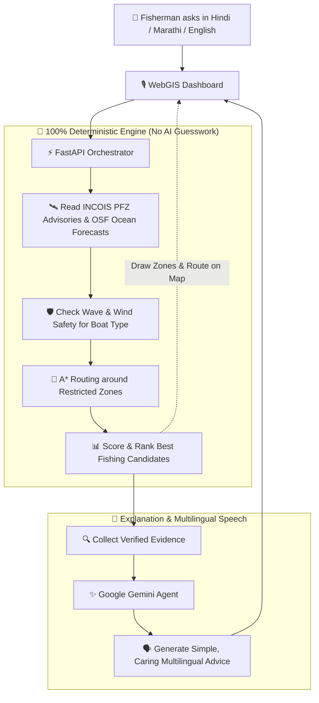

# 🌊 Project ORCA (Marine Intelligence for Fishermen)

<div align="center">

### 🛰️ Marine Ecosystem Reasoning with Collaborative Agents
**Smart India Hackathon (SIH 2026) • Problem Statement: SIH26176 • ISRO & INCOIS**

[](https://www.sih.gov.in/)
[](https://python.org)
[](https://fastapi.tiangolo.com/)
[](https://leafletjs.com/)
[](https://ai.google.dev/)
[](#)

<p align="center">
  <b>Transforming complex satellite Earth Observation & ocean forecast data into simple, life-saving voice advice for coastal fishermen. 🇮🇳</b>
</p>

[💡 The Problem](#-why-we-built-this-the-problem) •
[✨ What ORCA Does](#-what-orca-does) •
[🛠️ Tech Stack](#-tech-stack-we-used) •
[🚀 How to Run It](#-how-to-run-it-locally) •
[🚢 Vessel Safety Limits](#-vessel-safety-limits) •
[📡 API Endpoints](#-api-endpoints) •
[👥 Team & Credits](#-team--acknowledgements)

---

</div>

## 💡 Why We Built This (The Problem)

Every single day, Indian space and ocean agencies like **ISRO** and **INCOIS** generate incredible satellite datasets — Sea Surface Temperature (SST), Chlorophyll levels, Potential Fishing Zones (PFZs), wave heights, and weather forecasts.

**The Catch?** 🎣  
Most artisanal fishermen head out into deep waters in small wooden boats or trawlers without access to easy-to-understand information. Complex `.xls` coordinate sheets or technical meteorological maps are impractical to read on a rocking boat under the sun.

**Our Solution — ORCA:**  
We created an intelligent, multi-agent assistant that lets a fisherman simply speak or ask a question in **Hindi, Marathi, or English** (e.g. *"Where is the best safe fishing spot today near Mumbai?"*). ORCA handles the heavy math, checks wave hazards, finds the shortest safe route, and explains everything clearly — with **zero AI hallucinations**!

---

## ✨ What ORCA Does

- 🎙️ **Voice & Regional Languages:** Speak naturally in Hindi, Marathi, or English.
- 🐟 **Smart PFZ Matching:** Automatically reads INCOIS Potential Fishing Zone advisories to find the nearest high-yield spots.
- 🛡️ **Zero-Hallucination Safety Engine:** The AI **never** guesses wave heights or navigation coordinates. All risk calculations, wave limits, and distance checks are handled by deterministic Python GIS logic.
- 🧭 **A\* Safe Corridor Routing:** Calculates the safest path for boats while steering clear of restricted marine boundaries and rough waters.
- 🗺️ **Cyber-Ocean WebGIS Dashboard:** A clean, glassmorphism radar map built with Leaflet so port authorities and fishermen can see everything visually.
- 🔍 **Inspectable Evidence Ledger:** Every recommendation clearly shows where the data came from (agency, timestamp, live/cached status) so you can trust it.

---

## 🏗️ How It Works (Under the Hood)

Here is a quick look at how ORCA processes a question step-by-step:



---

## 🛠️ Tech Stack We Used

- **Frontend:** HTML5, Modern CSS (Glassmorphism "Cyber-Ocean" theme), Vanilla JS, **Leaflet.js** (WebGIS map).
- **Backend:** **Python 3.10+**, **FastAPI**, Uvicorn, Pydantic.
- **AI & Speech:** Google Gemini API (Natural language explanation & intent classification) + Web Speech API.
- **GIS & Algorithms:** Custom **A\* Pathfinding** routing, Haversine spatial calculations, CZMP boundary geofencing.
- **Data Ingestion:** Parsers for INCOIS `.xls` PFZ advisories, live/cached Ocean State Forecasts (OSF), and boundary JSON manifests.

---

## 🚀 How to Run It Locally

You can set this up on your local machine in just a few minutes! 💻

### ⚡ Option A: Quick Start (Windows One-Click)
Double-click [`run.bat`](./run.bat) or run it in your terminal:
```cmd
.\run.bat
```
*(This automatically verifies Python, creates `venv`, installs missing dependencies, opens `http://127.0.0.1:8000/` in your browser, and launches Uvicorn!)*

---

### 🛠️ Option B: Manual Setup

#### 1️⃣ Clone the Repo
```bash
git clone https://github.com/Legend2006H/ISRO-ORCA-Project.git
cd ISRO-ORCA-Project
```

#### 2️⃣ Set Up a Virtual Environment
```bash
# On Windows (PowerShell):
python -m venv venv
.\venv\Scripts\Activate.ps1

# On Linux / macOS:
python3 -m venv venv
source venv/bin/activate
```

#### 3️⃣ Install Required Packages
```bash
pip install -r requirements.txt
```

#### 4️⃣ Set Up Environment Variables (Optional)
```bash
cp .env.example .env
# You can add your GEMINI_API_KEY in .env if you want dynamic Gemini AI responses!
# (If no key is added, ORCA automatically uses its smart offline rule-engine fallback)
```

#### 5️⃣ Run the Server
```bash
uvicorn api.main:app --reload
```

#### 6️⃣ Open in Browser! 🎉
Navigate to **`http://127.0.0.1:8000`** in your browser to see the live dashboard!

---

## 🚢 Vessel Safety Limits

Different boats have different limits. ORCA changes its warning levels based on what you are sailing:

| Boat Type | Max Wave Height 🌊 | Max Wind Speed 💨 | Safe Range 📍 | Notes |
| :--- | :---: | :---: | :---: | :--- |
| 🛶 **Small Boat** | `1.5 m` | `10 m/s` (~19 kts) | `80 km` | Artisanal canoes & small motorboats. High sensitivity to rough seas. |
| 🚤 **Trawler** | `2.5 m` | `15 m/s` (~29 kts) | `150 km` | Standard mechanized coastal fishing boats. |
| 🚢 **Deep Sea Vessel** | `4.0 m` | `20 m/s` (~38 kts) | `300 km` | Large commercial vessels built for extreme offshore trips. |

---

## 📡 API Endpoints

If you want to test the backend API directly via Swagger UI (`http://127.0.0.1:8000/docs`):

| Endpoint | Method | What it does |
| :--- | :---: | :--- |
| `/health` | `GET` | Quick system health check and active data mode (`LIVE` vs `CACHED`). |
| `/api/v1/chat` | `POST` | The core intelligence endpoint! Takes query, GPS coords, language, and boat type. |
| `/api/v1/pfz/all` | `GET` | Gets all parsed Potential Fishing Zones as GeoJSON for maps. |
| `/api/v1/boundaries/all` | `GET` | Gets restricted coastal boundaries & CZMP buffer zones. |
| `/api/v1/ocean/live` | `GET` | Fetches live / cached wave height and ocean conditions. |
| `/api/v1/route` | `POST` | Calculates an A\* safe navigation route avoiding hazards. |
| `/api/v1/vessels` | `GET` | Lists all supported vessel profiles and threshold configurations. |

---

## 📂 Project Structure

```text
ISRO-ORCA-Project/
├── 🌐 index.html             # The main WebGIS mission-control dashboard
├── 🎨 styles.css             # Neon/ocean glassmorphism styling
├── ⚡ app.js                 # Frontend interactions, map plotting & speech
├── 📄 requirements.txt       # Python dependencies
├── 📁 api/                   # All backend code lives here
│   ├── main.py               # FastAPI server entry point
│   ├── models.py             # Data models & vessel limit schemas
│   ├── offline_service.py    # Deterministic calculation & fallback engine
│   ├── gemini_agent.py       # Gemini AI prompt orchestration
│   ├── incois_osf.py         # INCOIS Ocean State Forecast adapter
│   ├── live_marine.py        # Weather condition fetcher
│   ├── pfz_import.py         # Excel (.xls) advisory parser
│   ├── boundary_import.py    # Restricted zone validator
│   ├── routing.py            # A* shortest safe path algorithm
│   └── scoring.py            # Zone safety & potential scoring engine
└── 📁 data/                  # Sample datasets & manifests
    ├── manifests/            # Official boundary definitions
    └── raw/                  # PFZ advisories & cached ocean observations
```

---

## ⚠️ Important Note & Disclaimer

> 🚨 **Safety First:** This software is built as a hackathon prototype for decision support. In demonstration/cached mode, data is simulated or cached from historical records. Fishermen should always check official VHF radio broadcasts, IMD alerts, and local port warnings before heading to sea!

---

## 👥 Team & Acknowledgements

- 🏆 **Hackathon:** Smart India Hackathon (SIH 2026)
- 🚀 **Problem Statement:** SIH26176 (ISRO / INCOIS)
- 💙 **Special Thanks:** To **ISRO** and **INCOIS** for open oceanographic & Earth Observation data initiatives that inspire young engineers to build impactful solutions for our coastal communities.

---

<div align="center">
 
</div>
