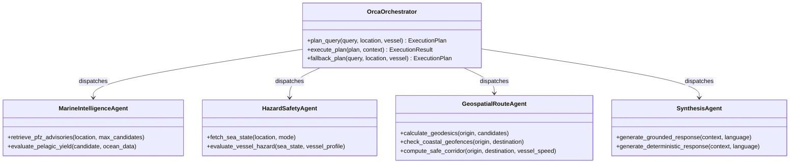
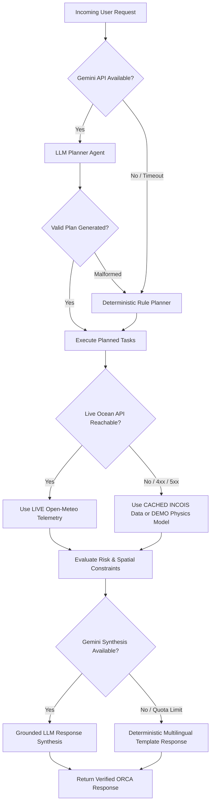

# ORCA: Agentic AI Architecture Design
**ISRO Problem Statement 26176: Marine EcOsystem Reasoning with Collaborative Agents**
**Architectural Phase:** Phase 2 — System Architecture & Multi-Agent Design

---

## 1. Executive Summary & Core Architectural Principle

ORCA is designed to solve the critical gap between complex, heterogeneous satellite Earth Observation (EO) / oceanographic forecasts and coastal fishermen. To align with ISRO Problem Statement 26176 while maintaining strict safety standards, ORCA adheres to the foundational principle:

> **"Agentic Orchestration over Deterministic Domain Tools"**
> 
> *The AI agentic layer is responsible for intent understanding, task planning, dynamic tool selection, inter-agent coordination, evidence synthesis, and natural multilingual explanation. The AI agentic layer is NEVER permitted to independently calculate or invent numerical wave heights, wind speeds, navigation coordinates, geodesic distances, safety limits, or risk scores.*

```
┌──────────────────────────────────────────────────────────────────────────────────────────────────┐
│                                     ORCA AGENTIC SYSTEM                                         │
├──────────────────────────────────────────────────────────────────────────────────────────────────┤
│  [Natural Language Query]                                                                        │
│         │                                                                                        │
│         ▼                                                                                        │
│  ┌────────────────────────────────────────────────────────────────────────────────────────────┐  │
│  │                            1. PLANNER & ORCHESTRATOR AGENT                                  │  │
│  │  • Intent Detection (Multilingual) • Location Entity Extraction • Dynamic Task Planning    │  │
│  └─────────────────┬──────────────────────────────┬─────────────────────────────┬─────────────┘  │
│                    │                              │                             │                │
│                    ▼                              ▼                             ▼                │
│  ┌─────────────────────────────────┐ ┌──────────────────────────┐ ┌───────────────────────────┐  │
│  │ 2. MARINE INTELLIGENCE AGENT    │ │ 3. HAZARD & SAFETY AGENT │ │ 4. GEOSPATIAL & ROUTE AGT │  │
│  │ • PFZ Advisory Ingestion        │ │ • Ocean State Ingestion  │ │ • Geodesic Spatial Metric │  │
│  │ • Chlorophyll/SST Pelagic Yield │ │ • Vessel Draft & Limits  │ │ • CZMP Geofence Checks    │  │
│  │ • Habitat Suitability Scoring   │ │ • Sea-State Risk Scoring │ │ • A* Corridor Pathfinding │  │
│  └─────────────────┬───────────────┘ └────────────┬─────────────┘ └─────────────┬─────────────┘  │
│                    │                              │                             │                │
│                    └───────────────────────┬──────┴─────────────────────────────┘                │
│                                            ▼                                                     │
│                    ┌────────────────────────────────────────────────────────────┐                │
│                    │           TYPED REASONING CONTEXT & EVIDENCE LEDGER        │                │
│                    │   Structured State • Data Provenance • Audit Telemetry     │                │
│                    └─────────────────────────────┬──────────────────────────────┘                │
│                                                  ▼                                               │
│                    ┌────────────────────────────────────────────────────────────┐                │
│                    │              5. SYNTHESIS & EXPLANATION AGENT              │                │
│                    │ • Evidence-Grounded Gemini LLM Synthesis • TTS Adaptation  │                │
│                    │ • Deterministic Template Fallback Engine (Zero-Latency)    │                │
│                    └─────────────────────────────┬──────────────────────────────┘                │
│                                                  ▼                                               │
│                                 [Verified Response + UI Telemetry]                               │
└──────────────────────────────────────────────────────────────────────────────────────────────────┘
```

---

## 2. Current Architecture vs. Target Agentic Architecture

### Current Architecture (Phase 1 Baseline)
In the Phase 1 implementation, `api/offline_service.py::analyse()` acts as a monolithic procedural pipeline:
1. Regex-based intent detection and entity extraction.
2. Ingestion of PFZ candidates and ocean cache / live feeds.
3. Computation of fishing and safety sub-scores for candidate points.
4. Deterministic multi-factor ranking in `api/scoring.py`.
5. A* navigation path calculation in `api/routing.py`.
6. Construction of an evidence array and procedural trace strings.
7. Delegation to `api/gemini_agent.py` for single-shot prompt synthesis (or procedural string templates).

### Target Agentic Architecture (Phase 2 Target)
The target architecture refactors the procedural flow into a **bounded, stateful Multi-Agent Collaborative System**:
- An **Orchestrator/Planner Agent** dynamically evaluates query intent and coastal context, generating an execution plan consisting of specific, required tasks.
- Specialized **Domain Worker Agents** execute deterministic tools wrapped in typed schemas, populating a shared execution context.
- Agents collaborate through a **Typed Execution Context** rather than unconstrained natural language chatter.
- A **Synthesis Agent** translates the verified context and evidence ledger into natural, compassionate, multilingual responses.
- If the LLM planner or network fails, a **Deterministic Planner Fallback** guarantees complete system operation with zero degradation in navigational safety.

---

## 3. The Minimum Specialized Agent Set

To prevent excessive token latency, indeterminism, and fragile agent chatter, ORCA defines **4 specialized collaborative agents** plus the Orchestration framework:



### Agent 1: Planner & Orchestrator Agent
- **Core Responsibility:** Parses incoming multi-turn requests, resolves geographic entities and vessel context, formulates an execution plan (DAG of sub-tasks), selectively invokes worker agents, and monitors execution bounds.
- **Decision Authority:** Decides *which* tools are needed for the user's specific intent (e.g. skipping A* routing for a simple weather check).
- **Restrictions:** Cannot calculate coordinates, distances, or safety limits.
- **LLM Powered:** Yes (Gemini Structured Outputs), with an automatic deterministic fallback parser.

### Agent 2: Marine Intelligence Agent
- **Core Responsibility:** Ingests official INCOIS Potential Fishing Zone (PFZ) advisories and evaluates oceanographic suitability (SST thermal gradients, chlorophyll-a upwelling proxies, bathymetric shelf breaks).
- **Decision Authority:** Determines candidate zone ranking factors for pelagic yield potential.
- **Restrictions:** Cannot clear a vessel for sailing if safety thresholds are exceeded.
- **LLM Powered:** No (Deterministic domain algorithms wrapping satellite and oceanographic parameters).

### Agent 3: Hazard & Safety Agent
- **Core Responsibility:** Ingests real-time and forecast ocean state telemetry (significant wave height, swell height, wave period, wind speed, surface currents) and evaluates safety clearance against vessel-specific operational thresholds.
- **Decision Authority:** Issues authoritative `BLOCKED` (High Risk) or `PERMITTED` safety statuses based on vessel profile constraints.
- **Restrictions:** Hard constraint enforcement — safety clearance cannot be bypassed by high fishing yield scores.
- **LLM Powered:** No (Deterministic safety logic).

### Agent 4: Geospatial & Route Agent
- **Core Responsibility:** Evaluates spatial topology, geodesic distances, restricted coastal/defense/CZMP geofences, and computes obstacle-avoiding A* navigation corridors with Chaikin path smoothing.
- **Decision Authority:** Identifies spatial obstructions and valid navigation waypoints.
- **Restrictions:** Cannot alter designated legal geofence boundaries.
- **LLM Powered:** No (Deterministic graph search and spatial algorithms).

### Agent 5: Synthesis & Explanation Agent
- **Core Responsibility:** Transforms the structured results, evidence items, and safety decisions into natural, empathetic, and culturally nuanced voice-ready text in Hindi, Marathi, or English.
- **Decision Authority:** Selects tone, phrasing, regional terminology, and summary emphasis based on user query intent.
- **Restrictions:** Strictly constrained by context payload; prohibited from stating numbers or coordinates not present in the evidence ledger.
- **LLM Powered:** Yes (Gemini generative model with structured system prompt), backed by deterministic templating engine.

---

## 4. Deterministic Domain Tool Boundaries

Every tool wraps an existing, verified function in the repository with a strict Pydantic contract:

| Tool Identifier | Wrapped Implementation | Input Schema | Output Schema | Nature | External API | Failure Behavior |
| :--- | :--- | :--- | :--- | :--- | :--- | :--- |
| `tool_resolve_coastal_entity` | `offline_service.extract_location_from_text` | `text: str` | `Location \| None` | Pure Deterministic | None | Returns `None`, retains default/active location. |
| `tool_fetch_ocean_telemetry` | `live_marine.fetch_live_marine_conditions`, `offline_service._ocean_cache` | `location: Location, use_live: bool` | `OceanObservationSet` | I/O Bound | Open-Meteo / INCOIS WMS | Falls back to verified local JSON cache or `DEMO` model. |
| `tool_lookup_pfz_advisory` | `offline_service._latest_pfz`, `pfz_import.read_pfz_xls` | `location: Location, max_count: int` | `list[PfzCandidate]` | Deterministic File I/O | Local `.xls` | Raises clear `AdvisoryNotFoundError`. |
| `tool_check_marine_geofences` | `boundary_import.read_restricted_zones_csv` | `points: list[Location]` | `list[GeofenceMatch]` | Pure Deterministic | Local `.csv` | Treats unverified boundaries as `CONTEXT_ONLY`. |
| `tool_calculate_safe_route` | `routing.plan_safe_route` | `origin: Location, dest: Location, speed_kmh: float` | `RoutePlan` | Pure Deterministic (A*) | None | Falls back to geodesic straight-line corridor with obstacle warnings. |
| `tool_evaluate_vessel_risk` | `models.VESSEL_PROFILES`, `offline_service._score` | `vessel_type: str, wave_m: float, wind_ms: float` | `SafetyAssessment` | Pure Deterministic | None | Fails closed (`departure_allowed: False`). |
| `tool_rank_fishing_zones` | `scoring.rank_zones`, `offline_service.compute_zone_fishing_metrics` | `candidates: list[ZoneCandidate]` | `list[RankedZone]` | Pure Deterministic | None | Applies deterministic multi-factor policy. |

---

## 5. Planner Design & Execution Graph

### Query-to-Plan Lifecycle

```
[User Query: "Is it safe to fish near Ratnagiri tomorrow morning in a small boat?"]
                               │
                               ▼
               ┌───────────────────────────────┐
               │    Planner Agent (Gemini)     │
               │   (or Deterministic Parser)   │
               └───────────────┬───────────────┘
                               ▼
               ┌───────────────────────────────┐
               │        EXECUTION PLAN         │
               │ Intent: SAFETY_ASSESSMENT     │
               │ Target: Ratnagiri (16.99N)    │
               │ Vessel: small_boat (Max 1.5m) │
               │ Tasks: [T1, T2, T3, T4, T5]   │
               └───────────────┬───────────────┘
                               │
       ┌───────────────────────┼────────────────────────┐
       ▼                       ▼                        ▼
┌──────────────┐       ┌───────────────┐       ┌────────────────┐
│ T1: Resolve  │       │ T2: Retrieve  │       │ T3: Ingest PFZ │
│ Location     │──────▶│ Ocean State   │──────▶│ Advisory       │
│ (Ratnagiri)  │       │ (Open-Meteo)  │       │ (INCOIS XLS)   │
└──────────────┘       └───────┬───────┘       └────────┬───────┘
                               │                        │
                               ▼                        ▼
                       ┌───────────────┐       ┌────────────────┐
                       │ T4: Evaluate  │       │ T5: Rank & Path│
                       │ Vessel Risk   │◀──────│ (Geodesic/CZMP)│
                       │ (Wave > 1.5m) │       │                │
                       └───────┬───────┘       └────────────────┘
                               │
                               ▼
               ┌───────────────────────────────┐
               │  Shared Context & Evidence    │
               │  Decision: BLOCKED (Wave 2.1m)│
               └───────────────┬───────────────┘
                               ▼
               ┌───────────────────────────────┐
               │   Synthesis Agent (Gemini)    │
               │  "Departure is blocked..."    │
               └───────────────────────────────┘
```

### Execution Constraints & Guardrails
To prevent infinite loops, unpredictable token consumption, and latency spikes:
1. **Maximum Planning Depth:** Exact DAG of max **6 task steps**.
2. **Maximum Tool Executions:** Capped at **8 tool calls** per request.
3. **Execution Timeout:** Strict **4.0-second total budget** for all tool executions.
4. **Zero Recursive Re-planning:** If a tool fails, the system executes deterministic fallback defaults rather than triggering recursive LLM re-prompt loops.
5. **No Hallucinated Tool Arguments:** Tool parameters must conform to strict Pydantic schemas; invalid parameter generations are automatically rejected and populated from verified session defaults.

---

## 6. Shared Reasoning & Context State Model

Agents interact by reading and writing to a strongly-typed shared state model (`OrcaExecutionContext`):

```python
class TaskStatus(str, Enum):
    PENDING = "PENDING"
    RUNNING = "RUNNING"
    COMPLETED = "COMPLETED"
    FAILED = "FAILED"
    SKIPPED = "SKIPPED"

class PlannedTask(BaseModel):
    task_id: str
    agent: str  # "marine", "hazard", "geospatial"
    tool_name: str
    arguments: dict[str, Any]
    status: TaskStatus = TaskStatus.PENDING
    dependencies: list[str] = []
    output: dict[str, Any] | None = None
    execution_time_ms: float = 0.0

class OrcaExecutionContext(BaseModel):
    request_id: str
    user_query: str
    detected_language: str = "en"
    query_intent: str = "recommendation"
    origin_location: Location
    target_vessel: VesselProfile
    use_live_data: bool = False
    
    # Domain Working Memory
    planned_tasks: list[PlannedTask] = []
    ocean_observations: dict[str, Any] = {}
    candidate_zones: list[ZoneCandidate] = []
    ranked_zones: list[RankedZone] = []
    safety_assessment: dict[str, Any] = {}
    navigation_route: dict[str, Any] | None = None
    
    # Trace & Evidence Ledger
    evidence_ledger: list[Evidence] = []
    operational_trace: list[str] = []
    
    # Final Output
    final_answer: str | None = None
    ai_provider: str = "DETERMINISTIC"
    execution_duration_ms: float = 0.0
```

---

## 7. Selective Tool-Execution Mapping

The Planner uses intent-specific task templates to avoid calling unnecessary tools:

| User Intent Category | Trigger Query Examples | Selected Tasks & Tools | Skipped Tools |
| :--- | :--- | :--- | :--- |
| **Zone Recommendation** | *"Where is the best fishing spot today?"* | 1. `tool_resolve_coastal_entity`<br>2. `tool_fetch_ocean_telemetry`<br>3. `tool_lookup_pfz_advisory`<br>4. `tool_evaluate_vessel_risk`<br>5. `tool_rank_fishing_zones`<br>6. `tool_calculate_safe_route` | None (Full Corridor Flow) |
| **Safety & Weather Check** | *"Is the sea safe for my small boat tomorrow?"* | 1. `tool_resolve_coastal_entity`<br>2. `tool_fetch_ocean_telemetry`<br>3. `tool_evaluate_vessel_risk` | `tool_lookup_pfz_advisory`<br>`tool_calculate_safe_route`<br>`tool_rank_fishing_zones` |
| **Zone Comparison / Why** | *"Why did you choose Zone A instead of B?"* | 1. `tool_lookup_pfz_advisory`<br>2. `tool_fetch_ocean_telemetry`<br>3. `tool_rank_fishing_zones` | `tool_calculate_safe_route` |
| **Worst Zone Avoidance** | *"Which zone has the highest hazard?"* | 1. `tool_lookup_pfz_advisory`<br>2. `tool_fetch_ocean_telemetry`<br>3. `tool_rank_fishing_zones` | `tool_calculate_safe_route` |
| **Navigational Routing** | *"Plan route from Sassoon Dock to PFZ 3"* | 1. `tool_check_marine_geofences`<br>2. `tool_calculate_safe_route` | `tool_lookup_pfz_advisory` |

---

## 8. Evidence Flow & Operational Reasoning Trace

### Provenance Tracking
Every factual datum that enters the context is packaged into a typed `Evidence` record:
```
Data Ingestion (Open-Meteo / INCOIS WMS / Local XLS)
       │
       ▼
Evidence Object (id, source, parameter, value, unit, location, valid_time, retrieved_at, source_mode, quality)
       │
       ▼
Evidence Ledger in Context (appended)
       │
       ▼
Referenced by ID in RankedZone candidates (e.g. evidence_ids: ["pfz_advisory", "osf_wave_height"])
       │
       ▼
Exposed to API / UI for user audit
```

### Operational Trace Design
The operational trace records *what the system executed* without exposing private internal prompts:
- `Planner: Decomposed query into 5 tasks (Intent: SAFETY_CHECK, Target: Malvan, Vessel: Trawler).`
- `Hazard Agent: Ingested ocean telemetry (Source: Open-Meteo, Wave: 1.8m, Wind: 11.2 m/s, Swell: 0.9m).`
- `Safety Engine: Evaluated vessel limits (Wave 1.8m <= 2.5m limit -> DEPARTURE PERMITTED).`
- `Marine Agent: Ingested 12 candidate PFZs from INCOIS Maharashtra Advisory.`
- `Route Engine: Computed 24.8 km A* safe corridor avoiding Malvan Reef buffer.`
- `Synthesis Agent: Grounded multilingual response generated in Marathi.`

---

## 9. LLM vs. Deterministic Boundary Matrix

| Capability / Function | Subsystem Assigned | Rationale |
| :--- | :--- | :--- |
| Intent Classification | **LLM** (with Regex fallback) | Tolerates user typos, broken grammar, colloquial slang, and multilingual queries. |
| Coastal Entity Extraction | **Deterministic Dictionary + Regex** (LLM assisted) | Coastal coordinates must map exactly to validated ports; prevents hallucinated lat/lons. |
| Wave/Wind Limit Enforcement | **Deterministic Engine** | Life-safety critical; zero tolerance for stochastic LLM boundary evaluations. |
| Geodesic Distance Calculations | **Deterministic GIS (Haversine)** | Exact mathematical formula; LLMs are notoriously poor at coordinate geometry. |
| Geofence Conflict Detection | **Deterministic Spatial Check** | Exact polygon/radius inclusion check against state security boundaries. |
| A* Corridor Pathfinding | **Deterministic Graph Algorithm** | Provably shortest obstacle-avoiding curve. |
| Pelagic Yield Scoring | **Deterministic Scoring Policy** | Transparent, versioned, and auditable scoring formula. |
| Multilingual Synthesis | **LLM (Gemini)** | Produces fluid, empathetic, voice-ready phrasing in Hindi, Marathi, and English. |
| Deterministic Synthesis Fallback | **Deterministic Template Engine** | Guarantees instant 0-latency response if LLM quota/network fails. |

---

## 10. Failure Handling & Graceful Degradation Matrix



| Failure Scenario | System Detection | Graceful Degradation Strategy |
| :--- | :--- | :--- |
| **Gemini API Outage / Missing Key** | `api_key is None` or HTTP Error | Bypasses LLM; uses `offline_service` deterministic planner and multilingual templates. |
| **Malformed Planner JSON** | Pydantic validation failure | Reverts immediately to default intent execution template for that query. |
| **Open-Meteo API Unreachable** | HTTP timeout / connection error | Falls back to cached INCOIS OSF JSON snapshot or spatial-temporal physics model (`DEMO` mode). |
| **Missing Coastal Entity in Query** | Extractor returns `None` | Uses active WebGIS map center coordinate or default harbour (Mumbai). |
| **Unknown Vessel Type** | Lookup in `VESSEL_PROFILES` fails | Defaults securely to `small_boat` (strictest 1.5m wave threshold). |
| **PFZ XLS Advisory Missing** | FileNotFoundError in `data/raw/pfz` | Emits clear warning evidence record and evaluates ocean safety only. |
| **Unreachable Navigation Target** | A* frontier exceeds max steps | Generates geodesic line corridor and flags obstacle penalty warnings. |

---

## 11. Technology & Framework Decision

### Evaluation of Frameworks

| Criterion | Custom Lightweight StateGraph (Recommended) | LangGraph / LangChain | CrewAI / AutoGen |
| :--- | :--- | :--- | :--- |
| **Dependency Overhead** | **Zero new packages** (retains lean `requirements.txt`) | Heavy (`langgraph`, `langchain-core`, `pydantic v1/v2` conflicts) | Heavy (`crewai`, `chromadb`, `instructor`, high complexity) |
| **Execution Latency** | **< 15ms orchestration overhead** | 150ms - 400ms overhead per step | 500ms - 2000ms overhead (excessive agent chatting) |
| **Deterministic Control** | **100% deterministic guardrails** & strict type checks | High complexity in state reduction loops | High indeterminism, prone to looping |
| **Hackathon Readiness** | **Completed & testable in 3 hours** | Requires steep debugging & graph setup | Fragile multi-agent prompts prone to hallucination |
| **Cold Start / Docker Size** | **Instant start, lightweight (~15MB venv)** | Large container footprint | Extremely large container footprint |

### Final Decision: **Custom Lightweight StateGraph**
ORCA will implement a lightweight, typed Python orchestration pattern (`OrcaOrchestrator`) with zero third-party agent framework bloat. It provides 100% of the required agentic capabilities (planning, tool dispatching, state propagation, typed evidence, fallback) while guaranteeing instant startup, zero dependency conflicts, and sub-second execution speeds.

---

## 12. Backward Compatibility & API Impact

### Existing API Endpoints (100% Preserved)
- `GET /health` — Preserved. Added agent configuration diagnostics.
- `POST /api/v1/chat` — Preserved with identical request/response schemas. Internally delegates to the agent orchestrator.
- `POST /api/v1/route` — Preserved. Directly calls `tool_calculate_safe_route`.
- `GET /api/v1/vessels` — Preserved. Returns vessel profiles and thresholds.
- `GET /api/v1/evidence/{id}` — Preserved. Fetches evidence from the shared ledger.
- `GET /api/v1/pfz/all` & `GET /api/v1/boundaries/all` — Preserved.

### Optional Future Diagnostic Endpoint (Phase 3)
- `POST /api/v1/agent/plan` — Optional debug endpoint to inspect generated DAG tasks without executing them.

---

## 13. Frontend Observability & UI Impact

The existing Cyber-Ocean dashboard (`index.html`, `app.js`, `styles.css`) already possesses rich UI components that seamlessly visualize agentic execution:
1. **Radar/Sonar HUD Sequencer**: Automatically synchronizes with agent lifecycle phases (`🛰️ Satellite PFZ` ➔ `🌊 Ocean OSF` ➔ `🧭 GIS Corridor` ➔ `🤖 Gemini AI`).
2. **Agent Trace Timeline (`#traceList`)**: Renders the dynamic execution trace produced by worker agents.
3. **Evidence Ledger (`#evidenceList`)**: Displays live/cached data provenance chips (`LIVE_FEED`, `VALIDATED_CACHE`, `SIMULATION_MODEL`).
4. **Interactive Copilot Panel**: Displays evidence-grounded recommendations with interactive quick-action buttons (`Show on Map`, `Plan Safe Route`, `Check Weather`).

*Zero frontend rewrites are needed; only minor binding enhancements to trace streams in Phase 3.*

---

## 14. 12-Hour Hackathon Feasibility Matrix

| Component / Feature | Classification | Estimated Dev Time | Justification |
| :--- | :--- | :--- | :--- |
| **`OrcaExecutionContext` & State Models** | **MUST HAVE** | 45 mins | Foundational typed contracts for all agent communications. |
| **Typed Domain Tool Wrappers** | **MUST HAVE** | 60 mins | Standardizes existing deterministic functions into callable tools. |
| **Dynamic Orchestrator & Task Dispatcher** | **MUST HAVE** | 90 mins | Executes planned tasks sequentially/dependently and records trace. |
| **Deterministic Rule-Planner Fallback** | **MUST HAVE** | 45 mins | Guarantees 100% test reliability and offline zero-key operation. |
| **LLM Structured Planner (Gemini)** | **MUST HAVE** | 60 mins | Produces dynamic task DAGs from natural language queries. |
| **Evidence Ledger Integration** | **MUST HAVE** | 30 mins | Binds tool execution records directly into the UI evidence inspector. |
| **Interactive Tool Plan Visualization in Trace** | **STRONG IF TIME** | 30 mins | Enhances the UI trace list with tool execution badges. |
| **Session Memory for Multi-Turn Clarifications** | **STRONG IF TIME** | 45 mins | Maintains active vessel and harbour across follow-up queries. |
| **Vector DB / RAG Pipeline** | **DO NOT BUILD** | — | Unnecessary complexity; domain data is structured GIS & XLS, not unstructured text. |
| **Autonomous Multi-Agent Debate / Chatting** | **DO NOT BUILD** | — | High latency, introduces hallucinations, and wastes hackathon tokens. |
| **Heavy Frameworks (CrewAI/LangGraph)** | **DO NOT BUILD** | — | High risk of environment breakages and dependency bloat. |

---

## 15. Architectural Vulnerability Review (Hostile Technical Defense)

### Q1: "Why do you need agents instead of simple procedural functions?"
**Architectural Defense:** Procedural code executes static pipelines (every query runs the exact same 10 functions). An agentic system interprets dynamic human intent, formulates a tailored execution plan, selectively invokes only the required tools (e.g. skipping A* routing for a weather question), and adapts dynamically to unexpected query structures or localized coordinates.

### Q2: "How do you prevent the LLM from hallucinating marine data or wave heights?"
**Architectural Defense:** The LLM is strictly isolated from data generation. All numerical observations (waves, wind, SST), distances, coordinates, and safety evaluations are computed by deterministic Python GIS tools. The LLM only receives structured context *after* deterministic computations are complete and is constrained by system prompts to synthesize that context.

### Q3: "What happens when the planner chooses the wrong tool or emits malformed JSON?"
**Architectural Defense:** The orchestrator validates all planner outputs against a strict Pydantic `ExecutionPlan` schema. If validation fails or a tool cannot execute, the orchestrator triggers an instant deterministic fallback plan tailored to the detected query intent.

### Q4: "How do you prevent infinite agent loops or runaway API costs?"
**Architectural Defense:** The system enforces a hard execution ceiling: maximum planning depth of 6, maximum tool executions of 8, and a 4.0-second timeout budget. Agents execute within a Directed Acyclic Graph (DAG) with zero circular feedback loops.

### Q5: "How do you validate agent-generated tool arguments?"
**Architectural Defense:** Worker agents wrap domain functions using strict Pydantic schemas. If an agent emits out-of-range coordinates or an unknown vessel type, the schema validator catches the error and populates safe defaults (e.g. default vessel profile and active map center).

### Q6: "Why didn't you use LangGraph, CrewAI, or AutoGen?"
**Architectural Defense:** Heavy third-party frameworks introduce significant cold-start latency (150ms-2000ms per step), 50+ dependency packages, and unpredictable agent chatter. Our lightweight StateGraph gives 100% deterministic control, sub-millisecond dispatching, and zero dependency conflicts.

### Q7: "What makes the agents truly collaborative rather than isolated scripts?"
**Architectural Defense:** Collaboration occurs through the shared `OrcaExecutionContext`. For example, the Geospatial Agent uses coordinates extracted by the Planner, the Hazard Agent evaluates ocean conditions relative to the active Vessel Profile, and the Scoring Engine combines outputs from both the Marine and Hazard agents to compute composite clearance.

### Q8: "How do you reproduce an agent's recommendation for safety audits?"
**Architectural Defense:** Every run produces a deterministic Evidence Ledger and Task Trace containing exact data timestamps, raw input parameters, source datasets (e.g. INCOIS XLS filename, WMS layer), and intermediate sub-scores. Given the same inputs, the deterministic tools always produce identical scores.

### Q9: "How do you handle stale or offline marine data?"
**Architectural Defense:** The system maintains strict source mode tracking (`LIVE`, `CACHED`, `DEMO`). When live APIs fail, the system transitions to timestamped local caches or physical simulation models, explicitly flagging the reduced confidence level in the evidence ledger and warning the operator.

### Q10: "Can an attractive fishing yield score override a dangerous wave warning?"
**Architectural Defense:** No. In `api/scoring.py` and the Hazard Agent, safety clearance is evaluated as a hard blocking gate. If wave height exceeds the vessel draft limit, the zone candidate's status is set to `BLOCKED`, preventing departure regardless of fishing score.

---

## 16. Key Trade-offs & Limitations

1. **Deterministic vs. Generative Balance:** We prioritized deterministic maritime safety over generative freedom. While this restricts conversational roleplay, it guarantees zero spatial hallucinations and dependable safety advice.
2. **Single-Node Execution:** The orchestrator runs in-process inside FastAPI rather than across distributed microservices. This is optimal for MVP hackathon execution speed and zero infrastructure complexity.
3. **Point-Based Boundary References:** Boundary geofences currently use point radii pending official state polygon GIS shapefile releases.
