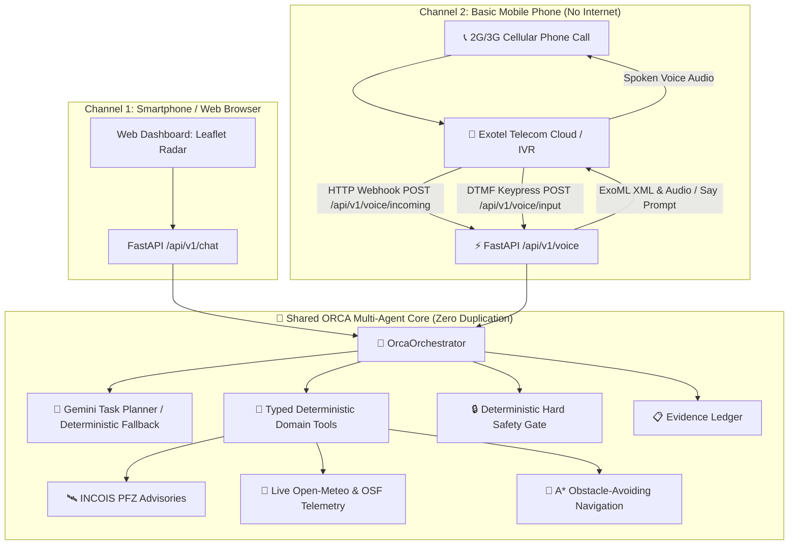

# 📞 ORCA Voice Access Layer (Telephony & IVR Architecture)

## Overview & Accessibility Goal

The **ORCA Voice Access Layer** enables artisanal coastal fishermen using basic cellular mobile phones (without smartphone screens, apps, or mobile internet access) to dial an ORCA helpline number and receive real-time, evidence-grounded marine safety advisories, Potential Fishing Zone (PFZ) coordinates, and safe navigation corridors via standard DTMF keypad inputs.

> ⚠️ **Connectivity & Infrastructure Notice:**
> The caller **only needs basic 2G/3G/4G cellular voice connectivity**. However, ORCA's cloud backend and the telephony carrier (Exotel) still require server-side network connectivity to fetch live ocean telemetry and execute GIS algorithms. Do NOT claim the backend itself is internet-independent.

---

## 🏗️ Architecture & Dual-Channel Model



---

## 📱 DTMF Keypad Menu Tree

The IVR interface uses a simple, deterministic multi-step state machine:

```
[📞 Incoming Call]
  └── Step 0: Language Selection
        ├── Press 1 ➔ Marathi (मराठी)
        ├── Press 2 ➔ Hindi (हिंदी)
        └── Press 3 ➔ English

  └── Step 1: Marine Intent Selection
        ├── Press 1 ➔ Marine Weather & Safety Verification
        ├── Press 2 ➔ Nearest Potential Fishing Zone (PFZ)
        └── Press 3 ➔ Safe Navigation Route

  └── Step 2: Coastal Port Selection
        ├── Press 1 ➔ Mumbai
        ├── Press 2 ➔ Ratnagiri
        ├── Press 3 ➔ Malvan
        ├── Press 4 ➔ Alibaug
        └── Press 5 ➔ Dahanu

  └── Step 3: Spoken Advisory & Navigation
        ├── Spoken Response: Port status + wave/wind + PFZ recommendation + Safety verdict
        ├── Press 9 ➔ Return to Main Menu
        └── Press 0 ➔ End Call (Hangup)
```

---

## 🔒 Deterministic Voice Safety Gate

Voice messages are **strictly constrained to verified facts in the evidence ledger**:
- If `wave_height > vessel_limit` or `wind_speed > vessel_limit`:
  - `departure_allowed = False`
  - Spoken output in Marathi: `"रत्नागिरी परिसर: गंभीर इशारा. समुद्रात जाऊ नका! लाटांची उंची २.२ मीटर आहे, जी १.५ मीटरच्या सुरक्षित मर्यादेपेक्षा जास्त आहे."`
  - Spoken output in Hindi: `"रत्नागिरी क्षेत्र: चेतावनी! समुद्र में न जाएँ। लहरों की ऊँचाई २.२ मीटर है, जो सुरक्षित सीमा १.५ मीटर से अधिक है।"`
  - Spoken output in English: `"Ratnagiri area: High Risk Alert. Do not depart! Wave height is 2.2 metres, exceeding the safe limit of 1.5 metres."`
- The system **never hallucinates numerical values**: distances, wave heights, and scores are derived verbatim from deterministic calculations.

---

## 🛰️ Live vs. Cached Data Provenance in Voice

The voice channel dynamically prepends honest attribution tags:
- **`LIVE` Feed:** `"थेट उपग्रह व सागरी माहितीनुसार: ..."` / `"Live marine telemetry: ..."`
- **`CACHED` Data:** `"नवीनतम अधिकृत माहितीनुसार: ..."` / `"Latest cached advisory: ..."`
- **`DEMO` Offline Model:** `"अंदाजित मॉडेलनुसार: ..."` / `"Fallback model advisory: ..."`

---

## 📡 Exotel Webhook Request / Response Contract

### 1. Incoming Call Webhook
- **Endpoint:** `POST /api/v1/voice/incoming`
- **Exotel Parameters:** `CallSid`, `CallUUID`, `From`, `CallFrom`, `To`, `Direction`, `CallType`
- **ORCA Response (ExoML XML with UTF-8):**
```xml
<?xml version="1.0" encoding="UTF-8"?>
<Response>
  <Gather action="/api/v1/voice/input" method="POST" numDigits="1" timeout="10">
    <Say>Welcome to ORCA Marine Safety Helpline. मराठी साठी १ दाबा. हिंदी के लिए २ दबाएँ. For English, press 3.</Say>
  </Gather>
</Response>
```

### 2. DTMF Keypress Webhook
- **Endpoint:** `POST /api/v1/voice/input`
- **Exotel Parameters:** `CallSid`, `Digits`, `From`
- **ORCA Response:** Advances the session state machine and returns the next `<Gather>` prompt or final `<Say>` advisory with menu navigation shortcuts.

### 3. Call Status Callback
- **Endpoint:** `POST /api/v1/voice/status`
- **Exotel Parameters:** `CallSid`, `Status`, `RecordingUrl`
- **ORCA Response:** `{"status": "acknowledged", "call_sid": "...", "call_status": "completed"}`

---

## 💰 Telephony Provider Cost & Trial Reality

| Aspect | Exotel Reality | Hackathon Impact / Mitigation |
| :--- | :--- | :--- |
| **Trial Availability** | 15-day free trial on signup with trial credits (~₹1,000 credit). | Sufficient for hackathon demonstration. |
| **Virtual Number** | Trial accounts provide a single virtual landline (e.g. 080-XXXXXXXX). | Inbound calls to this virtual number connect to ORCA webhooks. |
| **KYC / Verification** | Requires business email & caller ID verification. | If verification is delayed, use the **Local Simulation Harness** or **Twilio Voice**. |
| **Paid Production** | Commercial plans start at ~₹19,999/yr + call charges (~₹1.20/min). | For hackathon judging, the developer trial account or simulation harness is recommended. |
| **Recommended Alternative** | **Twilio Programmable Voice** ($15.50 instant credit, instant virtual number, TwiML `<Response><Gather><Say>` 100% compatible). | Zero business verification delay; instant live telephone line. |

---

## 🚀 LIVE HACKATHON DEMO GUIDE

### 1. Provider Account & Number Requirements
- **Option A (Exotel):** Exotel trial account with assigned Virtual Number.
- **Option B (Twilio):** Twilio trial account with assigned Phone Number.
- **Option C (Local Simulation Harness):** Zero-carrier simulation using `POST /api/v1/voice/simulate`.

### 2. Backend Deployment Requirements
1. Deploy ORCA backend to a public HTTPS URL (e.g., Render, Railway, AWS, or local tunnel `ngrok http 8000`).
2. Verify public health check: `curl https://<your-domain>/health`.

### 3. Environment Variables Configuration
```env
# Exotel / Telephony Configuration
EXOTEL_API_KEY=your_exotel_api_key
EXOTEL_API_TOKEN=your_exotel_api_token
EXOTEL_ACCOUNT_SID=your_exotel_account_sid
EXOTEL_PHONE_NUMBER=your_exotel_virtual_number
```

### 4. Public Webhook Configuration in Exotel Dashboard
1. Log into **Exotel Dashboard** $\to$ **Applets** $\to$ **Create Custom Applet**.
2. Select **Passthru / Voice URL**.
3. Set Webhook URL to: `https://<your-domain>/api/v1/voice/incoming` (HTTP Method: `POST`).
4. Bind this Applet to your Exotel Virtual Number.

### 5. Step-by-Step Test Call Sequence
1. Dial the Exotel Virtual Number from a normal phone.
2. **Step 0 (Language):** Press `1` for Marathi (`मराठी`).
3. **Step 1 (Intent):** Press `1` for Marine Weather & Safety (`सागरी हवामान व सुरक्षा`).
4. **Step 2 (Port):** Press `2` for Ratnagiri (`रत्नागिरी`).
5. **Step 3 (Advisory):** Hear live spoken advisory:
   > *"थेट उपग्रह व सागरी माहितीनुसार: रत्नागिरी परिसर: गंभीर इशारा. समुद्रात जाऊ नका! लाटांची उंची २.२ मीटर आहे, जी १.५ मीटरच्या सुरक्षित मर्यादेपेक्षा जास्त आहे. मुख्य मेनूसाठी ९ दाबा. कॉल समाप्त करण्यासाठी ० दाबा."*

---

## 🎤 60–90 Second Hackathon Judging Demonstration Script

1. **Show WebGIS Dashboard:** Open ORCA on a laptop/projector showing live sea-state and radar for Ratnagiri.
2. **Show Basic Phone:** Hold up a basic mobile phone with **mobile data and Wi-Fi disabled** (or a simple feature phone).
3. **Dial Helpline:** Dial the ORCA helpline number on speakerphone.
4. **Interactive Keypad Navigation:**
   - Press `1` (Marathi)
   - Press `1` (Safety)
   - Press `2` (Ratnagiri)
5. **Audible Verification:** The audience hears the real-time spoken advisory matching the dashboard's live wave height (e.g., 2.2m) and blocked safety verdict.
6. **Closing Pitch:**  
   *"Notice that the phone has no mobile internet. It only needs basic cellular voice calling. The call reaches our ORCA backend through Exotel, where the exact same multi-agent safety gate and deterministic oceanographic calculations generate the live advisory."*
