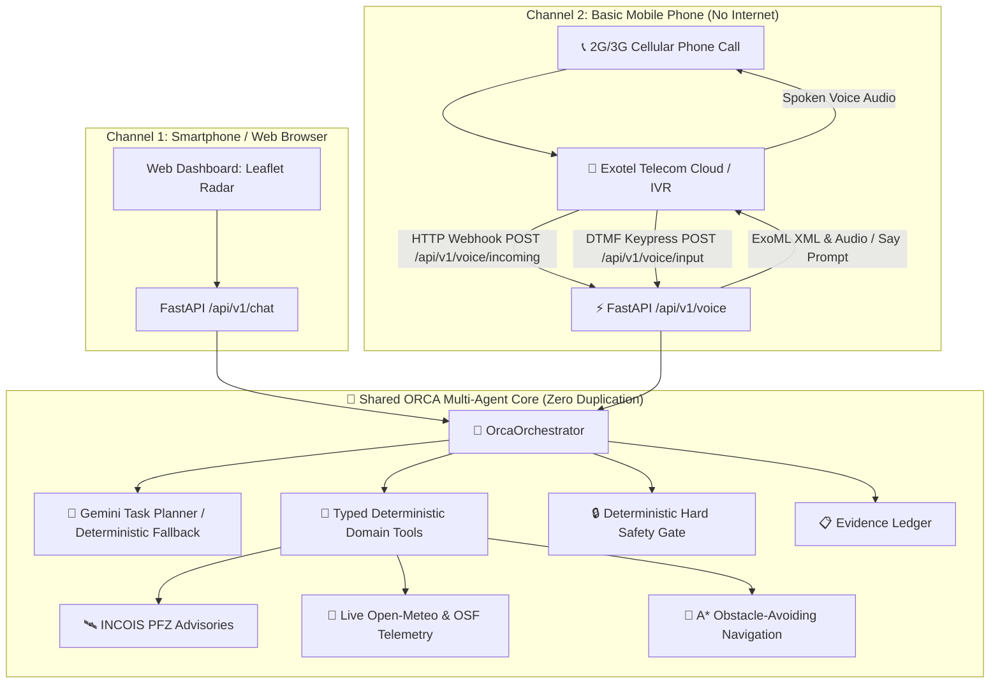

# 📞 ORCA Voice Access Layer (Telephony & IVR Architecture)

## Overview & Accessibility Goal

The **ORCA Voice Access Layer** enables artisanal coastal fishermen using basic cellular mobile phones (without smartphone screens, apps, or mobile internet access) to dial an ORCA helpline number and receive real-time, evidence-grounded marine safety advisories, Potential Fishing Zone (PFZ) coordinates, and safe navigation corridors via standard DTMF keypad inputs.

> ⚠️ **Connectivity & Infrastructure Notice:**
> The caller **only needs basic 2G/3G/4G cellular voice connectivity**. However, ORCA's cloud backend and the telephony carrier (Exotel) still require server-side network connectivity to fetch live ocean telemetry and execute GIS algorithms. Do NOT claim the backend itself is internet-independent.

---

## 🏗️ Architecture & Dual-Channel Model



---

## 📱 DTMF Keypad Menu Tree

The IVR interface uses a simple, deterministic multi-step state machine:

```
[📞 Incoming Call]
  └── Step 0: Language Selection
        ├── Press 1 ➔ Marathi (मराठी)
        ├── Press 2 ➔ Hindi (हिंदी)
        └── Press 3 ➔ English

  └── Step 1: Marine Intent Selection
        ├── Press 1 ➔ Marine Weather & Safety Verification
        ├── Press 2 ➔ Nearest Potential Fishing Zone (PFZ)
        └── Press 3 ➔ Safe Navigation Route

  └── Step 2: Coastal Port Selection
        ├── Press 1 ➔ Mumbai
        ├── Press 2 ➔ Ratnagiri
        ├── Press 3 ➔ Malvan
        ├── Press 4 ➔ Alibaug
        └── Press 5 ➔ Dahanu

  └── Step 3: Spoken Advisory & Navigation
        ├── Spoken Response: Port status + wave/wind + PFZ recommendation + Safety verdict
        ├── Press 9 ➔ Return to Main Menu
        └── Press 0 ➔ End Call (Hangup)
```

---

## 🔒 Deterministic Voice Safety Gate

Voice messages are **strictly constrained to verified facts in the evidence ledger**:
- If `wave_height > vessel_limit` or `wind_speed > vessel_limit`:
  - `departure_allowed = False`
  - Spoken output in Marathi: `"रत्नागिरी परिसर: गंभीर इशारा. समुद्रात जाऊ नका! लाटांची उंची २.२ मीटर आहे, जी १.५ मीटरच्या सुरक्षित मर्यादेपेक्षा जास्त आहे."`
  - Spoken output in Hindi: `"रत्नागिरी क्षेत्र: चेतावनी! समुद्र में न जाएँ। लहरों की ऊँचाई २.२ मीटर है, जो सुरक्षित सीमा १.५ मीटर से अधिक है।"`
  - Spoken output in English: `"Ratnagiri area: High Risk Alert. Do not depart! Wave height is 2.2 metres, exceeding the safe limit of 1.5 metres."`
- The system **never hallucinates numerical values**: distances, wave heights, and scores are derived verbatim from deterministic calculations.

---

## 🛰️ Live vs. Cached Data Provenance in Voice

The voice channel dynamically prepends honest attribution tags:
- **`LIVE` Feed:** `"थेट उपग्रह व सागरी माहितीनुसार: ..."` / `"Live marine telemetry: ..."`
- **`CACHED` Data:** `"नवीनतम अधिकृत माहितीनुसार: ..."` / `"Latest cached advisory: ..."`
- **`DEMO` Offline Model:** `"अंदाजित मॉडेलनुसार: ..."` / `"Fallback model advisory: ..."`

---

## 📡 Exotel Webhook Request / Response Contract

### 1. Incoming Call Webhook
- **Endpoint:** `POST /api/v1/voice/incoming`
- **Exotel Parameters:** `CallSid`, `CallUUID`, `From`, `CallFrom`, `To`, `Direction`, `CallType`
- **ORCA Response (ExoML XML with UTF-8):**
```xml
<?xml version="1.0" encoding="UTF-8"?>
<Response>
  <Gather action="/api/v1/voice/input" method="POST" numDigits="1" timeout="10">
    <Say>Welcome to ORCA Marine Safety Helpline. मराठी साठी १ दाबा. हिंदी के लिए २ दबाएँ. For English, press 3.</Say>
  </Gather>
</Response>
```

### 2. DTMF Keypress Webhook
- **Endpoint:** `POST /api/v1/voice/input`
- **Exotel Parameters:** `CallSid`, `Digits`, `From`
- **ORCA Response:** Advances the session state machine and returns the next `<Gather>` prompt or final `<Say>` advisory with menu navigation shortcuts.

### 3. Call Status Callback
- **Endpoint:** `POST /api/v1/voice/status`
- **Exotel Parameters:** `CallSid`, `Status`, `RecordingUrl`
- **ORCA Response:** `{"status": "acknowledged", "call_sid": "...", "call_status": "completed"}`

---

## ⚙️ Environment Variables

Add to your local `.env`:
```env
# Telephony / IVR Integration (Exotel)
EXOTEL_API_KEY=your_exotel_api_key_here
EXOTEL_API_TOKEN=your_exotel_api_token_here
EXOTEL_ACCOUNT_SID=your_exotel_account_sid_here
EXOTEL_PHONE_NUMBER=your_exotel_virtual_number_here
```

---

## 🧪 Local Simulation vs. Live Exotel Integration

| Feature | Local Simulation Mode | Live Exotel Integration |
| :--- | :--- | :--- |
| **Trigger** | `POST /api/v1/voice/simulate` or curl | Real telephone cellular call to virtual number |
| **Phone Internet** | Not applicable (JSON/HTTP client) | **Zero internet required on mobile phone** |
| **Backend Internet** | Uses live Open-Meteo or fallback | Uses live Open-Meteo or fallback |
| **ExoML XML** | Returned in JSON response for inspection | Streamed directly to Exotel voice synthesizer |
| **Cost** | 100% Free / Local | Standard Exotel trial/production rates |

### Step-by-Step Local CLI Testing:
```bash
# 1. Start Call (Step 0: Greeting)
curl -X POST http://127.0.0.1:8000/api/v1/voice/simulate \
  -H "Content-Type: application/json" \
  -d '{"call_id": "test-101"}'

# 2. Select Marathi (Step 1: Intent Menu)
curl -X POST http://127.0.0.1:8000/api/v1/voice/simulate \
  -H "Content-Type: application/json" \
  -d '{"call_id": "test-101", "digits": "1"}'

# 3. Select Marine Safety (Step 2: Location Menu)
curl -X POST http://127.0.0.1:8000/api/v1/voice/simulate \
  -H "Content-Type: application/json" \
  -d '{"call_id": "test-101", "digits": "1"}'

# 4. Select Ratnagiri (Step 3: Advisory Execution)
curl -X POST http://127.0.0.1:8000/api/v1/voice/simulate \
  -H "Content-Type: application/json" \
  -d '{"call_id": "test-101", "digits": "2"}'
```

---

## 🛡️ Security & Privacy Considerations
1. **Zero Credential Exposure:** Internal API keys and server stack traces are never exposed over voice or HTTP headers.
2. **Caller Privacy:** Caller phone numbers are masked in logs and session storage (`+91******3210`).
3. **Strict DTMF Allowlist:** Callers can only trigger validated options (`1`–`5`, `9`, `0`); arbitrary parameter injection is impossible.
4. **Session TTL Isolation:** Voice sessions automatically expire after 300 seconds (5 minutes) to prevent memory leaks and stale state reuse.
5. **Idempotency Protection:** Repeated callbacks with identical inputs re-serve the current state safely without duplicate computation.

---

## 🚀 Steps to Connect a Live Exotel Number (Production Setup)
1. **Obtain Exotel Account & Virtual Number:** Sign up at [exotel.com](https://exotel.com/) and acquire a virtual Landline/Mobile number.
2. **Deploy ORCA Backend:** Deploy ORCA to a public HTTPS domain (e.g. Render, Railway, AWS EC2) with valid SSL.
3. **Configure Exotel Applet:**
   - In the Exotel Dashboard, create a **Passthru Applet** or **Custom Flow**.
   - Set the URL to: `https://<your-domain>/api/v1/voice/incoming`.
   - Set the HTTP method to `POST`.
4. **Bind Applet to Number:** Assign the created applet to your Exotel virtual number.
5. **Dial and Verify:** Call the Exotel virtual number from any standard mobile phone to hear the live ORCA multi-language voice advisory.

---

## 🎤 60–90 Second Hackathon Judging Demonstration Script

1. **Step 1:** Open the ORCA WebGIS Dashboard on screen to demonstrate the live interactive radar map and telemetry for Ratnagiri.
2. **Step 2:** Hold up a basic mobile phone (or toggle Airplane Mode on with Wi-Fi off to show zero data connectivity).
3. **Step 3:** Dial the ORCA Exotel helpline number on speakerphone.
4. **Step 4:** Listen to the initial multilingual prompt, then press `1` on the keypad for Marathi.
5. **Step 5:** Press `1` for Marine Weather & Safety, then press `2` for Ratnagiri.
6. **Step 6:** Hear the real-time spoken advisory matching the dashboard's live wave and safety verdict.
7. **Step 7 (Pitch):**  
   *"Notice that the phone has no mobile internet. It only needs basic cellular calling. The call reaches our ORCA backend through Exotel, where the exact same multi-agent safety gate and deterministic oceanographic calculations generate the live advisory."*
